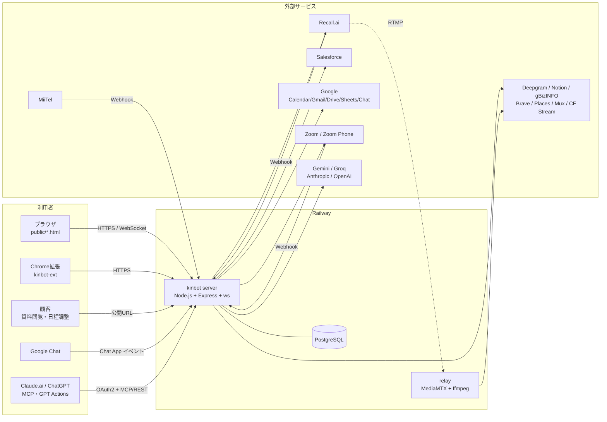
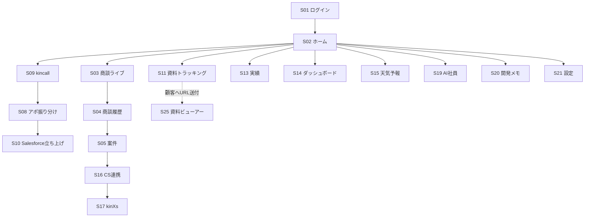

# kinbot 基本設計書

| 項目 | 内容 |
|---|---|
| 対象システム | kinbot（営業支援システム。kincall / kinXs / SHOBO を含む） |
| 版 | 1.0（2026-11-16 時点のソースコードから作成） |
| 基準ビルド | `server/index.js` の `BUILD_TAG`（2026-11-13zc） |
| 関連資料 | [02_詳細設計書](02_詳細設計書.md) / [03_シーケンス図](03_シーケンス図.md) / [04_ユースケース図](04_ユースケース図.md) / [05_ER図](05_ER図.md) / [06_DBモデル](06_DBモデル.md) |

---

## 1. システム概要

### 1.1 目的
B2B営業の「商談前 → 商談中 → 商談後」を一本につなぎ、Neo Career / C Career の営業チーム（DOC・MOCHICA）の
架電・アポ獲得・商談・Salesforce記録・CS引き継ぎまでの手作業を減らす。**現場が毎日使う業務システム**であり、停止は業務停止に直結する。

### 1.2 対象業務とサブシステム

| サブシステム | 主な利用者 | 範囲 |
|---|---|---|
| kincall（架電） | インサイド・インターン | 架電リスト作成、架電先の割当・スコアリング、架電結果記録、再架電（リサイクル）、メルマガ配信 |
| アポ管理 | インサイド・管理者 | アポ（スマートリンク）作成、クローザー自動割当、アポ確定メール、Salesforce立ち上げ |
| 商談支援（kinbot本体） | クローザー | 会議にBotを入室させ、リアルタイム文字起こし・要約・AI提案、フェーズ判定、議事録・SF記録 |
| 資料トラッキング | クローザー | 資料の閲覧リンク発行、閲覧時間・ページの計測、閲覧通知 |
| 案件・分析 | クローザー・管理者 | 案件一覧、案件イベント、受注/失注分析、実績レポート、週次ボード |
| kinXs（CS・既存顧客） | CS | 既存顧客台帳、タスク、施策対応、メール下書き、応募（AR）取込 |
| SHOBO | MOCHICA営業 | MiiTel会議の取込、BALESリード集計 |
| AI社員・外部AI連携 | 全員・管理者 | Google Chatからの操作、自動改善、MCP / GPT Actions による外部AIからの参照・更新 |

### 1.3 システム構成

### 1.4 技術スタック

| 層 | 採用技術 |
|---|---|
| 実行環境 | Node.js 18.17+（ES Modules） |
| Webサーバー | Express 4 / WebSocket（`ws`、パス `/ws`） |
| DB | PostgreSQL（`pg`）。DBが無効な場合はメモリ動作に縮退 |
| 画面 | 素のHTML/CSS/JavaScript（フレームワーク無し）、カード型UI |
| ファイル処理 | multer、xlsx、officeparser、pdf-parse |
| ブラウザ自動操作 | playwright-core + @sparticuz/chromium（CS Platform登録用） |
| ホスティング | Railway（本体・relayの2サービス）。mainへのpushで自動デプロイ |
| CI/自動改善 | GitHub Actions（ci / hourly / night / advisor / rollback） |

---

## 2. 機能一覧

### 2.1 業務機能

| ID | 機能 | 概要 | 主なAPI | 主なテーブル |
|---|---|---|---|---|
| F01 | ログイン・ユーザー管理 | メール+パスワードでの登録・ログイン、メンバー・役割・チーム・シフト管理、なりすまし | `/api/me` `/api/members` `/api/teams` `/api/interns` `/api/shift` `/api/impersonate` | users, members, interns, inside_shifts |
| F02 | 外部アカウント連携 | Google / Salesforce のOAuth連携 | `/auth/google` `/auth/salesforce` | google_accounts, salesforce_accounts |
| F03 | 架電リスト管理 | リスト・グループ作成、架電先取込、スコア・温度・営業時間、日次割当（ボックス） | `/api/calls/lists` `/api/calls/targets` `/api/calls/boxes` | call_lists, call_targets, call_boxes, place_hours |
| F04 | 架電結果記録 | 結果・メモ登録、SFタスク作成、Zoom Phone録音要約、プロセスシート書込 | `/api/calls/*` `/api/zoom-phone/*` `/api/process-sheet` | call_logs, zoom_rec_summaries |
| F05 | 再架電・育成 | 断り理由タグに応じた再架電予定、リスト間の育成移動 | `/api/calls/recycle-*` `/api/calls/nurture-*` | recycle_rules, call_targets |
| F06 | メルマガ配信 | 架電先へのメール一斉配信、開封・クリック計測、配信停止 | `/api/calls/mailmaga*` `/m/:token` `/u/:token` | mailmaga_campaigns, mailmaga_sends, mail_optout |
| F07 | アポ登録・割当 | アポ（スマートリンク）作成、クローザーのローテーション自動割当、休止管理 | `/api/smart-links` `/api/apo/*` | smart_links, closer_rotation, team_rotation, closer_suspensions, assign_log |
| F08 | アポメール | アポ確定メール・前日リマインド自動送付、バウンス検知 | `/api/apo-mail*` `/api/mail-templates` | apo_mail_log |
| F09 | Salesforce立ち上げ | リードのコンバート→商談作成の自動化、商談の手動紐付け | `/api/sf-autolaunch` `/api/salesforce/*` | sf_autolaunch, company_sf_link |
| F10 | Bot入室（手動・自動） | 会議URLへRecall Botを入室。Googleカレンダーから自動入室 | `/api/sessions` `/api/auto-join` `/api/calendar` | meetings, calendar_bots, calendar_watch, auto_join_meetings |
| F11 | リアルタイム商談支援 | 文字起こし・要約・AI提案のWebSocket配信、Q&A、ナレッジ検索 | `/api/recall/webhook` `/ws` | meetings, qa_bank, knowledge_chunks |
| F12 | AI音声アシスタント（かささぎ） | 商談中にAIが音声で回答（TTS） | `/api/kasasagi/*` | kasasagi_* |
| F13 | 商談後処理 | 議事録・フェーズ判定・次アクション抽出、お礼メール、SF記録、Notion/Drive保存 | `/api/meetings/*` `/api/next-actions` `/api/thanks-*` `/api/notion` | meetings, phase_judgments, meeting_followup, next_actions, sf_updates |
| F14 | 案件管理・分析 | 案件・案件イベント、特徴タグ、受注/失注インサイト、営業スタイル分析 | `/api/deals` `/api/deal-events` `/api/weekly` | deals, deal_events, deal_feature_tags, win_insights |
| F15 | 資料トラッキング | 資料アップロード、顧客別閲覧リンク（期限・パスワード）、閲覧計測・通知 | `/api/docs` `/api/doc-links` `/d/:slug` `/api/doc/*` | doc_files, doc_links, doc_views, doc_events |
| F16 | 日程調整・計測リンク | 顧客向け日程調整ページ、計測付きリダイレクト | `/api/booking` `/b/:slug` `/api/jump` `/j/*` | book_pages, book_views, jump_links, jump_views |
| F17 | 実績・レポート | 日次・週次・月次実績、アポ目標、利用ログ、CSV出力 | `/api/report` `/api/daily` `/api/usage` | apo_goals, daily_apo_targets, usage_events, weekly_board |
| F18 | CS引き継ぎ | 受注後のキックオフ登録、CS確認日程、Chat投稿、CS Platform登録 | `/api/cs/*` | cs_kickoffs, cs_mail_links, cs_mail_hits |
| F19 | kinXs（既存顧客管理） | 契約の更新管理（更新月×更新確度）、タスク、施策対応、メール下書き（メールワイズ）、自動更新（AR）の解約フォーム取込・納品一覧同期 | `/api/kinxs/*` | kinxs_* |
| F20 | MOCHICA連携 | MiiTel会議取込（Webhook・拡張機能）、BALESリード集計 | `/api/mochica/*` | mochica_miitel_events, meetings |
| F21 | ナレッジ | PDF・URLの取込、チャンク化と埋め込み、RAG検索、フォルダ・公開範囲 | `/api/knowledge` `/api/qa-bank` | knowledge, knowledge_chunks, kb_folders |
| F22 | 通知・Chat操作 | Google Chat通知（種別ごとON/OFF）、`@kinbot` コマンド | `/api/chat*` | chat_targets, chat_sent |
| F23 | 外部AI連携 | MCP（`/mcp` `/kincall/mcp` `/kinxs/mcp`）、GPT Actions、OAuth 2.0（動的クライアント登録＋PKCE） | `/mcp` `/oauth/*` `/.well-known/*` | oauth_clients, oauth_codes, oauth_tokens |
| F24 | ライブ配信 | 商談映像のライブ配信（Mux / Cloudflare Stream、relay経由） | `/api/live/*` `/api/mux` | live_relay |
| F25 | AI社員・自己点検 | 開発メモの蓄積、自動改善（GitHub Actions）、自己点検、UIレビュー、デプロイ通知 | `/api/dev-notes` `/api/self-check` `/api/deploy` | dev_notes, dev_dismissed, deploy_log |
| F26 | 共有Zoom貸出 | 共有Zoomアカウントの貸出・返却、拡張機能による自動ログイン | `/api/zoom-share/*` | zoom_shared, zoom_checkouts |

APIは約900本あり、多い順に `/api/calls`（約206）、`/api/kinxs`（約94）、`/api/apo`（約60）、`/api/salesforce`（約54）、`/api/meetings`（約48）。

### 2.2 バッチ（定期処理）

サーバー内の `setInterval` で動く（外部cronは使わない）。主なものは次のとおり。

| 周期 | 処理 | 内容 |
|---|---|---|
| 1分 | apoScanTick | 社員のカレンダーからアポを検知し、スマートリンク作成・担当割当（間隔は15〜900秒で設定可。Calendar push通知で即時実行もあり） |
| 1分 | startAutoJoinCalendarMonitor | 登録URL方式の自動入室判定（`CALENDAR_AUTO_JOIN=1` のとき） |
| 1分 | 各種通知判定 | 架電レポート・開発メモまとめ・デプロイ通知・夕方通知・週次リマインド |
| 2分 | scheduler（予約Bot） | 連携ユーザーのGoogleカレンダーを見て、会議開始 `BOT_JOIN_LEAD_MIN` 分前に入室するBotをRecallへ予約 |
| 2分 | arIntake | kinXs：自動更新（AR）の解約フォーム回答を取込・突合 |
| 5分 | checkValidDeals / checkDocDeals / csTick / dailyGoalTick | 有効商談判定・資料閲覧通知・CS処理・日次目標 |
| 10分 | sweepMeetingSfRecords / runNurtureAuto / linkReschedPairs | 商談のSF自動記録・育成移動・リスケの紐付け |
| 15分 | mcCalMatchRun | MOCHICA商談とカレンダーの突き合わせ |
| 15分 | syncZoomCallHistory / syncZoomRecordings | Zoom Phoneの通話履歴・録音を取得し、架電ログ・録音要約に反映 |
| 30分 | processSheetTick / recallReconcileTick / auditAllCallLists / kinxsSync / judgeSweep | プロセスシート書込・Recall整合・架電リストのSF監査・kinXs同期・フェーズ判定 |
| 1時間 | autoLose / arSyncSheet / kxAutoTasksTick | 期限切れ案件の自動失注・納品一覧同期・CS自動タスク |
| 6時間 | runRecycleToCold / cleanup | 冷えた架電先の移動・不要データ掃除 |

GitHub Actions：`ci.yml`（push/PRで構文＋smoke）、`kinbot-hourly.yml`（毎時の自動改善）、`kinbot-night.yml`（夜間開発→PR）、`kinbot-advisor.yml`（定期提案）、`kinbot-rollback.yml`（手動ロールバック）。※2026-11時点で schedule は停止中。

---

## 3. 画面一覧

| 画面ID | ファイル | 画面名 | 概要 | 認証 |
|---|---|---|---|---|
| S01 | login.html / register.html | ログイン / 新規登録 | メール・パスワード認証 | 不要 |
| S02 | home.html | ホーム | 本日の予定、各ツールへの入口 | 要 |
| S03 | index.html | 商談ライブ | Bot入室、文字起こし・要約・提案のリアルタイム表示 | 要 |
| S04 | history.html | 商談履歴 | 過去商談、温度感 | 要 |
| S05 | deals.html | 案件 | 案件一覧・イベント | 要 |
| S06 | analysis.html | 分析 | 商談分析 | 要 |
| S07 | style-analysis.html | 営業スタイル分析 | 担当者ごとの営業スタイル | 要 |
| S08 | apo.html | アポ振り分け | アポ割当・ローテーション・除外 | 要 |
| S09 | calls.html | kincall | 架電リスト・架電先・メルマガ | 要 |
| S10 | sf-launch.html | Salesforce | SF立ち上げ（コンバート） | 要 |
| S11 | docs.html | 資料トラッキング | 資料・リンク・閲覧状況 | 要 |
| S12 | proposals.html | 提案資料 | 提案資料の蓄積・検索 | 要 |
| S13 | report.html | 実績 | 実績レポート | 要 |
| S14 | dashboard.html | ダッシュボード | KPI俯瞰 | 要 |
| S15 | weekly.html | 天気予報 | 週次ボード・温度感 | 要 |
| S16 | cs.html | CS連携 | キックオフ・引き継ぎ | 要 |
| S17 | kinxs.html | kinXs | 既存顧客管理 | 要 |
| S18 | mochica.html | SHOBO | MiiTel取込・BALES集計 | 要 |
| S19 | ai.html | AI社員 | AIとのチャット・状態確認 | 要 |
| S20 | dev.html | 開発メモ | 要望・バグ・自動改善の指示 | 要 |
| S21 | settings.html | 設定 | 個人・全体設定、外部連携 | 要 |
| S22 | shift.html | シフト提出 | インサイドのシフト提出 | 要 |
| S23 | switch.html | 入退室 | 入退室（PWA） | 要 |
| S24 | kasasagi-face.html | かささぎ | AI音声アシスタントのアバター | 要 |
| S25 | doc.html (`/d/:slug`) | 資料ビューアー | 顧客向け資料閲覧（計測付き） | 不要 |
| S26 | book.html (`/b/:slug`) | 日程のご調整 | 顧客向け日程調整 | 不要 |

共通部品：`nav.js`（ナビゲーション）、`cmdk.js`（コマンドパレット）、`kbchat.js`（チャット）、`style.css`。

### 画面遷移（主要）

---

## 4. 外部インターフェース一覧

| ID | 連携先 | 方向 | 方式・認証（環境変数名） | 用途 |
|---|---|---|---|---|
| IF01 | Recall.ai | 双方向 | REST（`RECALL_API_KEY`）＋Webhook（`RECALL_WEBHOOK_SECRET`） | Bot入室・退出、文字起こし、録画 |
| IF02 | Salesforce | 送信 | OAuth 2.0（`SF_CLIENT_ID`等）、ユーザー別トークン | リード・商談・タスク・レポートの読み書き、コンバート |
| IF03 | Google Calendar / Gmail / Drive / Sheets | 双方向 | OAuth 2.0（`GOOGLE_CLIENT_ID`等）、Calendar push通知 | 予定取得・招待、メール送信・下書き、資料保管、プロセスシート |
| IF04 | Google Chat | 双方向 | Webhook / サービスアカウント（`GOOGLE_CHAT_*`） | 通知、`@kinbot` コマンド |
| IF05 | Zoom / Zoom Phone | 双方向 | Server-to-Server OAuth（`ZOOM_*`）＋Webhook | 通話履歴・録音同期 |
| IF06 | MiiTel | 受信 | Webhook（Bearer合言葉）、拡張機能（`x-kb-ext`署名トークン） | 会議の文字起こし・議事録・録画取込 |
| IF07 | LLM（Gemini 他） | 送信 | APIキー（`GEMINI_API_KEY`、予備キーで自動切替、Groq等へフォールバック） | 要約・提案・構造化抽出・埋め込み・文字起こし |
| IF08 | Deepgram | 送信 | APIキー | 話者分離つき文字起こし |
| IF09 | Notion | 送信 | トークン | 商談記録の蓄積 |
| IF10 | gBizINFO / Brave Search / Google Places | 送信 | APIキー | 法人情報・公式URL・営業時間の補完 |
| IF11 | Mux / Cloudflare Stream / relay | 送信 | トークン、`RELAY_SECRET` | ライブ配信 |
| IF12 | CS Platform | 送信 | ブラウザ自動操作（`CSP_*`） | 企業登録（APIが無いため） |
| IF13 | MCPクライアント / ChatGPT | 受信 | OAuth 2.0（`kbtat_` トークン）/ `API_TOKENS` | 外部AIからの参照・更新 |
| IF14 | GitHub / Railway | 双方向 | トークン、Deploy hook | 自動改善の起動、デプロイ通知 |

---

## 5. 非機能要件

### 5.1 セキュリティ
- **認証**：Cookie（`kinbot_session`、署名付き）によるセッション。パスワードは scrypt でハッシュ化。登録は合言葉（`SIGNUP_CODE`）と許可ドメイン（`ALLOWED_EMAIL_DOMAIN`）で制限。
- **API認証**：Cookie / Bearer（`API_TOKENS`、タイミング安全比較）/ OAuthアクセストークン（`oauth_tokens`）の順で判定。
- **権限**：admin（`ADMIN_EMAILS`）、クローザー・インサイド等の役割（`members.roles`）、kincall専用ユーザー。多くの `/api/*` は「adminまたはクローザー」のみ許可。
- **公開URL**：資料閲覧・日程調整・計測リンク・Webhook受信のみ認証不要（`OPEN_PATHS`）。資料リンクは期限・パスワード・失効に対応。
- **秘密情報**：APIキー・トークンは環境変数のみ。コード・ログ・画面に出さない。共有Zoomのパスワードは暗号化して保存。
- **外部AIからの書込**：Salesforceへの書込は `KINBOT_SF_MCP` の許可リストで制限。

### 5.2 可用性・信頼性
- 単一Railwayサービス構成。mainへのpushで自動デプロイ、CI（構文チェック＋smoke）を通過したものだけを反映。
- `/healthz` によるヘルスチェック、`/api/self-check` による自己点検、Actionsによるロールバック。
- LLMは予備キー・別プロバイダへのフェールオーバーあり。Recallは30分ごとに整合（reconcile）。
- Webhookは即時200応答し、処理は非同期。
- DB接続が無い場合はメモリ動作に縮退（データは保持されない）。

### 5.3 保守性
- スキーマは起動時に `CREATE TABLE IF NOT EXISTS` / `ADD COLUMN IF NOT EXISTS` で冪等に作成・拡張。**既存データを消す変更はしない**。
- 版管理：`BUILD_TAG`・`BUILD_FEATURES`（`/api/version`）、画面の `?v=` キャッシュ破棄（`dev/bump-version.mjs`）。
- push前に `node dev/precheck.mjs`（構文・パース・HTMLタグ・smoke）を必ず実行。
- 依存ライブラリを増やさない、フレームワークを導入しない。

### 5.4 ログ・監視
- `console.*` に `[apo-scan]` 等のタグ付きで出力（Railwayのログ）。
- 業務ログはDBに保存：deploy_log / usage_events / apo_mail_log / kinxs_mail_log / chat_sent / assign_log。
- 異常・デプロイ・日次サマリはGoogle Chatへ通知。

### 5.5 性能
- 商談中のライブ分析は設定 `liveAiSuggest` がONのときのみ（既定OFF）。間隔は `ANALYZE_INTERVAL_MS`（既定30秒）、新規文字数が一定未満なら分析しない。LLMが429のときは60秒休止。
- カレンダー取得はキャッシュ（`CAL_CACHE_MS`）と同時実行数（`CAL_FETCH_CONCURRENCY`）で制御。
- 集計分析は `set_analysis_cache` に fingerprint 付きでキャッシュ。

---

## 6. 運用

| 項目 | 内容 |
|---|---|
| デプロイ | GitHub main → Railway 自動デプロイ（CI通過が条件） |
| 起動確認 | `[apo-scan] 自動スキャンの間隔` のログ、`/healthz`、`/api/version` |
| ロールバック | `kinbot-rollback.yml`（直近の自動変更 or 指定sha を revert） |
| 自動改善 | 開発メモ → hourly/night ワークフロー（安全なものは本番、それ以外はPR）。稼働時間とON/OFFは設定（`autoImprove` / `autoApply`） |
| 主担当 | 田中（クローザー）。SF管理は SDG |

---

## 7. 補足
- `kincs` は kinXs 画面の権限を絞ったコピー（販売管理部向け）。`kincs_users`（招待ユーザー）と `kincs_overlay`（上書きデータ）を持つ。
- MiiTel会議を商談履歴（meetings）に入れる変更は 2026-11-12 に取り消し済み。現在は `mochica_miitel_events` にのみ保存する。

## 8. 未確認事項
- `/api/feature-c`（9本）、`/api/aidemo` の業務上の位置づけ
- GPT Actions の正確なエンドポイント数
