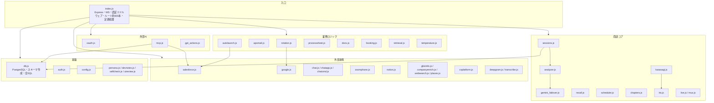

# kinbot 詳細設計書

| 項目 | 内容 |
|---|---|
| 版 | 1.0（2026-11-16 時点のソースコードから作成） |
| 前提 | [01_基本設計書](01_基本設計書.md) |
| 行番号 | `server/index.js` 等の行番号は作成時点のもの。改修で変わるので関数名で検索すること |

---

## 1. モジュール構成

| ファイル | 責務 |
|---|---|
| index.js | HTTPルート・WebSocket・認証ミドルウェア・定期処理の登録・業務処理の大半（アポ走査、SF立ち上げ、kincall、kinXs等） |
| db.js | DB接続、起動時のスキーマ作成・列追加、全テーブルのCRUD関数 |
| auth.js | 登録・ログイン・署名Cookie・管理者判定・代理ログイン |
| config.js | ユーザー別設定の解決（`resolveConfig`） |
| recall.js | Recall.ai APIクライアント、Webhook本文の解析 |
| sessions.js | 商談セッション（メモリ）、WS配信、ライブ分析、終了時の事後分析 |
| analyzer.js | LLM呼び出し（プロバイダ切替・フォールバック）と各種プロンプト（47関数） |
| gemini_failover.js | `globalThis.fetch` を差し替え、Gemini宛て通信の予備キー切替・別モデル再送・Groq迂回 |
| scheduler.js | カレンダーからの予約Bot作成 |
| rotation.js | クローザー割当の候補並べ替え・空き判定・確定 |
| apomail.js | アポ確定メール・前日リマインドのテンプレート展開と送信 |
| autolaunch.js | SF立ち上げ可否判定の純関数（タイトル解析・リード判定・理由コード） |
| processsheet.js | プロセスシートのレイアウト解析・集計・更新セル生成（純関数） |
| docs.js | 資料閲覧の計測・通知・シート記録 |
| oauth.js / mcp.js / gpt_actions.js | 外部AI向けOAuthサーバー・MCP（JSON-RPC）・GPT Actions REST |
| salesforce.js / google.js / zoomphone.js / chat.js | 各外部サービスのクライアント |

---

## 2. 共通設計

### 2.1 認証ミドルウェア（index.js 約980〜1080行）

判定順：

1. `authEnabled()` が偽 → admin として通す
2. `OPEN_PATHS` および公開プレフィックス（`/j/` `/g/` `/d/` `/px/` `/c/` `/m/` `/u/` `/b/` `/api/booking/` `/api/doc/`）→ 認証なし
3. `Authorization: Bearer`（または `?token=`）を `API_TOKENS`（`トークン:ユーザー`）とタイミング安全比較
4. `kbtat_` で始まるBearer → `oauth_tokens` を照合
5. Cookie `kinbot_session` を `verifyToken`（`base64url(id).HMAC-SHA256`）で検証。用途付きトークン（`gconnect|…`）はログインに使えない
6. 未認証：`/api/*` `/mcp` 等は 401、画面は `/login.html?next=`
7. `kincsOnly` / `kincallOnly` ユーザーは許可パス以外を 403 またはリダイレクト

### 2.2 権限

| 区分 | 判定 | 主な許可範囲 |
|---|---|---|
| admin | `ADMIN_EMAILS` / `ADMIN_USERS`（`isAdmin`） | 全機能、設定、メンバー管理、代理ログイン（許可された2アカウントのみ） |
| クローザー / インサイド | `members.roles`、`ALWAYS_CLOSER_EMAILS`（`isCloserUser`） | 多くの `/api/*`（「adminまたはクローザー」） |
| kincall専用 | `req.kincallOnly` | kincall画面とAPIのみ |
| kincs専用 | `kincsOnly` | kincs画面とAPIのみ |
| APIトークン | `API_TOKENS`。ユーザー省略または `ADMIN_EMAILS` 該当で admin | GPT Actions、MCP |
| 外部AI（OAuth） | `oauth_tokens.is_admin` | MCPツール。SF書込は `KINBOT_SF_MCP` の許可リスト |

### 2.3 エラー処理・ログ
- Webhook（Recall / Zoom / MiiTel）は**先に200を返し**、`setImmediate` で非同期処理する（再送・タイムアウトを避けるため）。
- 外部API失敗は呼び出し元で握りつぶさず、`*_error` 列（`call_logs.sf_error`、`chat_targets.last_error`、`kinxs_files.chat_error` 等）に残し、必要に応じてGoogle Chatへ1回だけ通知する。
- 画面に返すエラーは日本語で「何が起きたか・どうすればよいか」を書く。
- ログは `console.*` に `[apo-scan]` `[cs]` 等のタグを付ける。秘密値は出力しない。

### 2.4 冪等性・二重実行防止

| 対象 | 方法 |
|---|---|
| 予約Bot | `calendar_bots`（owner::eventId） |
| 登録URLの自動入室 | `auto_join_meetings.last_joined_at`（30分以内は抑止）、プロセス内 `joinedEventKeys` |
| アポ割当 | プロセス内 `_assignLocks` ＋ DB `claimAssign/releaseAssign`、`smart_links.auto_assigned_at` |
| アポメール | `apo_mail_log` を送信前に確認（`apoMailSentRow`） |
| SFの活動記録 | `createTaskIdempotent(botId)`（`findTaskByBotId`） |
| Zoom通話ログ | `call_logs.zoom_call_id = zoom:<id>` |
| 資料閲覧通知 | `doc_views.notified` |
| AR取込 | `kinxs_ar_inbox.row_key`（UNIQUE） |
| カレンダー通知 | `calendar_notice`（event_id, kind） |
| 手入力の保護 | `_manual` 列（`meetings.apo_setter_manual`）、プロセスシートは `psShadow` と比較 |

### 2.5 LLM呼び出し
- 入口：`analyzer.callLLM`（analyzer.js:1205）。`LLM_PROVIDER`（既定 gemini）で `callOnce` → 失敗時 `fallbackChain`（`FALLBACK_PROVIDER`：groq / anthropic / openai / ollama）。
- `gemini_failover.js` が `fetch` を横取りし、
  - 429 / 403 / キー無効 / 課金エラー → `GEMINI_API_KEY_BACKUP` に切替（30分間維持）
  - 503等の混雑 → `GEMINI_FALLBACK_MODELS` の別モデルで再送（`sendWithBusyRetry`）
  - `textViaGroq` ON かつ短文のみ → 先に Groq へ、失敗で Gemini に戻す
- 構造化JSON抽出では 2.5-flash 系に `thinkingConfig.thinkingBudget: 0` を指定し、出力上限に余裕を持たせる（思考トークンで出力が切れるため）。

### 2.6 設定値の保持
- 全体設定：`settings`（id=1 の JSONB）。例：`liveAiSuggest` `autoImprove` `autoApply` `psAutoRun` `psOwner` `docSheetId` `arReplyOn` `zoomAutoSync` `apoRotationNextOrder`
- 個人設定：`user_settings.data`
- 環境変数：秘密値・外部接続先・機能フラグ（`CALENDAR_AUTO_JOIN` `LIVE_STREAM_ENABLED` `URA_FALLBACK` 等）

---

## 3. 機能別詳細

### 3.1 商談中リアルタイム支援（F10・F11） → [SQ01](03_シーケンス図.md#sq01-商談中リアルタイム支援入室文字起こし分析) / [SQ02](03_シーケンス図.md#sq02-商談終了事後処理)

**API**

| メソッド | パス | 処理 |
|---|---|---|
| POST | /api/sessions | `startBotSession` → `recall.createBot` → `sessions.createSession`（`meetings` INSERT） |
| POST | /api/sessions/:id/stop | `leaveBot` → `removeSession` |
| POST | /api/recall/webhook | `verifyRecallRequest`（`x-shodan-secret`）→ 200 → 非同期で解析 |
| WS | /ws?session=botId | Cookie認証 → `Session.addSocket` |

**Recall Bot 作成パラメータ（recall.js:91 `createBot`）**：`meeting_url` / `bot_name` / `join_at`（予約時）/ `recording_config.video_mixed_mp4` / `transcript.provider`（`buildProvider`：recallai_streaming・Deepgram等、言語 ja）/ `diarization` / `realtime_endpoints`（`transcript.data` `transcript.partial_data` `participant_events.chat_message`）/ `automatic_leave`（待機室・無人・全員退出・録音拒否のタイムアウト）

**WebSocket メッセージ（サーバー → 画面）**

| type | 内容 |
|---|---|
| session | startedAt, repName, muxPlaybackId, isOwner |
| final / partial | speaker, text（確定 / 途中） |
| analysis | summary, coverage, objections, landed, suggestions |
| answering / answer / answer_failed | 顧客質問への回答案 |
| status | no_session / analyze_error |
| ended | 終了 |

**ライブ分析条件（`Session.maybeAnalyze`）**：設定 `liveAiSuggest=true`（既定OFF）／新規文字数 ≥ `MIN_NEW_CHARS`／429クールダウン中でない／社内MTG等のタイトルでない。間隔 `ANALYZE_INTERVAL_MS`（既定30秒）。

**終了検知（3経路）**：Recall webhook の終了イベント／`startSessionMonitor`（30秒ごと `getBot`）／手動停止。`BOT_MAX_HOURS`（既定4時間）超過は10分ごとの見張りで退出。

**事後処理（`finalizeAnalysis` → `onMeetingFinalized`）**

| 順 | 処理 | 出力先 |
|---|---|---|
| 1 | analyzeMeeting（要約・営業フィードバック） | meetings.analysis |
| 2 | splitPhases / buildChapters | meetings.chapters |
| 3 | extractQaPairs | qa_bank |
| 4 | analyzeDeep → 状態が 進行中/受注/失注/保留 なら setDealStatusAuto | deal_status |
| 5 | classifyMeetingKind → extractFirstMeeting / extractReMeeting → resolveDeal | deals, deal_events, deal_feature_tags |
| 6 | 録画取得（0〜300秒の段階リトライ）→ Driveへ保存 | meetings.drive_file_id / drive_link |
| 7 | SF活動ToDo自動記録（10分ごとの見回り、最大5回） | Salesforce Task, meetings.sf_recorded_at |

### 3.2 カレンダー自動入室（F10） → [SQ03](03_シーケンス図.md#sq03-カレンダー自動入室予約bot)

前提：`CALENDAR_AUTO_JOIN=1`。

| 経路 | 起動 | 判定 | 重複防止 |
|---|---|---|---|
| 予約Bot（scheduler.js） | 120秒ごと | 連携ユーザーの予定に会議URL。【社内MTG】【ユ/フォ】は除外 | calendar_bots |
| 登録URL（startAutoJoinCalendarMonitor） | 60秒ごと | 開始2分前〜4分後。ミーティングID一致、または `calendar_any=true` | last_joined_at（30分）、joinedEventKeys |
| Zoom Webhook | meeting.started | `findAutoJoinByMeetingId` | 直近5分の入室 |

起動1分後に `repairRecentMeetings` が「無題」「担当なし」の直近商談をカレンダーから補完する。

### 3.3 アポ検知・担当割当・SF立ち上げ（F07〜F09） → [SQ04](03_シーケンス図.md#sq04-アポ検知--担当割当--確定メール--sf立ち上げ)

**アポ検知（`collectApoAppointments`）**
- 対象者：`listInterns()` ＋ `listClosers()` のカレンダー
- 対象予定：タイトルに【初回】【新/ヒ】等のタグ
- `getSmartLinkByEvent` で既存確認 → なければ `createSmartLink`（slug は `zoomLikeSlug`、URL `/j/<slug>`）
- 除外：kinbotが作った予定、kincall登録済みアポ。リスケ/キャンセルは `handleHeadStates`、カレンダーから消えた予定は `dropDeletedApos`
- 起動：60秒ごと（15〜900秒で設定可、15分ごとに全期間再確認、それ以外は差分）＋ Calendar push 通知（`/api/google/calendar-push`、`x-goog-channel-token` 照合、3秒後に実行）

**担当選定（`rotation.pickCloser`）**

| 段階 | 内容 |
|---|---|
| 1 | 自分で取ったアポ（`selfAcquired`）は取得者が担当 |
| 2 | kincall由来でリスト限定ルールがあれば候補を絞る |
| 3 | 候補 = 事業（DOC/MOCHICA）の有効クローザー − 休止中（closer_suspensions） |
| 4 | 並び順：飛ばされた人（priority）→ 次の順番（apoRotationNextOrder）→ チーム均衡 → 予備メンバー |
| 5 | 各候補の予定と `bufferMin` で空き判定（`isPersonFree`） |
| 6 | 全員埋まり：`URA_FALLBACK=1` のときのみ代替担当、それ以外は失敗記録＋Chat通知 |
| 7 | 確定：`setSmartLinkOwner` → `commitAssignment`（closer_rotation / team_rotation / assign_log / settings 更新）→ `markAutoAssigned` |

**SF立ち上げ判定（autolaunch.js `judge`）**：タイトルから会社名・担当者名を取得 → `searchLeads(company)` → クロスのリードが1件に絞れ、担当者名が一致すること。満たさない場合は `ensureCrossLead` で救済（必要ならリード作成）。gBizINFOでURL補完、業種・必須項目確認、`ensureLead*` で各日付・流入元・FSメモを書込 → `convertLead`（`/actions/standard/convertLead`、商談名 `会社_担当者`）→ `sfQuery` で商談の存在確認。結果は `sf_autolaunch`（reason は `REASONS` のコード）。失敗分は `GET /api/sf-autolaunch/pending`・`POST /api/sf-autolaunch/retry` で再試行。

> コンバートは不可逆。`sfAutoLaunch` 設定がOFFのときは `dryRun` で判定のみ行う。

### 3.4 架電（F03〜F06） → [SQ05](03_シーケンス図.md#sq05-架電kincallと結果記録) / [SQ06](03_シーケンス図.md#sq06-プロセスシート書き込み)

| API | 処理 |
|---|---|
| POST /api/calls/lists, /from-csv, /from-leads, /from-report, /lists/:id/fill-from-sf | リスト作成と架電先投入（CSV・SFリード・SFレポート） |
| GET /api/calls/next?list= | `nextCallTarget(listId, caller)` |
| POST /api/calls/record | `recordCall`（call_logs）→ 非同期 `syncCallToSf`（SF Task 作成）→ `markCallSynced` |
| /api/calls/recycle-*, /nurture-* | 断り理由タグ（recycle_rules）に応じた再架電・育成移動 |
| /api/calls/enrich-* | 従業員数・媒体・業種・採用人数の補完（LLM＋Brave/gBizINFO） |
| /api/zoom-phone/sync, /sync-recordings | Zoom Phone 手動同期 |

**架電先の主な状態列（call_targets）**：`stage` / `status` / `temperature` / `score`・`score_breakdown` / `next_call_at` / `consecutive_absent`・`absent_rank` / `excluded`・`excluded_reason` / `reject_tag` / `recall_count` / `origin_list_id`・`list_trail`（育成移動の履歴）

**プロセスシート**：`PS_INTERVAL_MIN`（既定30分）・`PS_HOURS`（既定7-22）・平日のみ・`psAutoRun` ON。既定は dryRun。手入力セルは `psShadow` との比較で上書きしない。シート保護で403のときは Apps Script（`docs/kinbot-sheet-writer.gs`）経由で書く。

### 3.5 資料トラッキング（F15・F16） → [SQ07](03_シーケンス図.md#sq07-資料トラッキング)

| パス | 認証 | 処理 |
|---|---|---|
| POST /api/docs | 要 | 資料を doc_files（BYTEA）に保存 |
| POST /api/doc-links, /bulk | 要 | 閲覧リンク発行（期限・合言葉・名前確認・まとめ配布・共通URL） |
| GET /d/:slug | 不要 | ビューアー表示。期限切れ410、なし404 |
| POST /api/doc/:slug/open | 不要 | 合言葉・名前確認 → doc_views 開始（IPはハッシュ） |
| POST /api/doc/:slug/beat | 不要 | 秒数・最大ページ・ページ別滞在を更新。final で終了処理 |
| GET /px/:file | 不要 | 開封ピクセル（doc_events kind=open） |
| GET /c/:slug?u= | 不要 | クリック記録して302 |
| GET /g/:slug | 不要 | jump_views 記録・Chat通知（同一相手30分に1回）・転送 |
| GET /j/:slug | 不要 | アポのスマートリンク → 担当者の Zoom へ転送 |

閲覧通知：`NOTIFY_MIN_SECONDS` 以上で Chat 通知（120秒以上は強調、回数と前回からの間隔、よく見たページ）。`docSheetId` 設定時はシートへ追記。閉じる合図の無い閲覧は3分ごとの `sweepStaleViews(90秒)` で終了扱い。

### 3.6 外部AI連携（F23） → [SQ08](03_シーケンス図.md#sq08-外部ai連携oauth-20--mcp)

| 項目 | 仕様 |
|---|---|
| メタデータ | RFC 8414 / RFC 9728。grant: authorization_code, refresh_token。PKCE: S256, plain |
| 動的登録 | POST /oauth/register → oauth_clients |
| 認可コード | `kbtcode…`、1回限り（`consumeOauthCode`） |
| アクセストークン | `kbtat_…`、有効90日、scope=mcp。リフレッシュ時は旧トークンを削除して再発行 |
| MCP | Streamable HTTP（JSON-RPC 2.0 POST）。`initialize` / `tools/list` / `tools/call` / `ping`。リクエスト上限40MB |
| エンドポイント | `/mcp`（TOOLS）、`/kincall/mcp`（CALL_TOOLS）、`/kinxs/mcp`（KINXS_TOOLS） |
| GPT Actions | `GET /api/gpt/deals` `/deals/:id` `/deal-events` `/meetings` `/meetings/:bot_id` `/account`。固定Bearer（API_TOKENS）。スキーマ `docs/gpt-actions-openapi.yaml` |

**MCPツール（/mcp）**

| 分類 | ツール |
|---|---|
| 閲覧 | list_deals, get_deal_events, get_deal_detail, list_meetings, get_meeting_detail, get_account_detail |
| 架電 | list_call_logs, list_call_stats, list_call_lists_overview, list_apo_appointments |
| Salesforce | sf_query, sf_update, sf_create（`canUseSf` / `sfOwnerFor`、`KINBOT_SF_MCP` で許可制） |
| MOCHICA | mochica_miitel_imported_ids, mochica_miitel_import |

### 3.7 認証（F01・F02） → [SQ09](03_シーケンス図.md#sq09-ログイン)

| 項目 | 仕様 |
|---|---|
| 登録 | POST /api/register。`SIGNUP_CODE`・メール形式・パスワード8文字以上・`ALLOWED_EMAIL_DOMAIN` を検証。scrypt（ランダムソルト、`salt:hash`） |
| ログイン | POST /api/login。DBユーザー → 失敗時は旧方式（`USERS` / `APP_PASSWORD`） |
| Cookie | `kinbot_session` = `base64url(id).HMAC-SHA256(SECRET)`。HttpOnly / Secure / SameSite=Lax / 30日 |
| ログアウト | POST /api/logout |
| 代理ログイン | `canImpersonate`（固定2アカウント）、Cookie `kbt_imp`、/api/impersonate/stop |
| 別Chromeへ引き継ぎ | POST /api/auth/handoff → GET /auth/handoff（1回限り） |
| Google連携 | /auth/google → callback → `google_accounts`。state は署名トークン |
| Salesforce連携 | /auth/salesforce（PKCE）→ callback → `salesforce_accounts` |

### 3.8 kinXs（F19） → [SQ10](03_シーケンス図.md#sq10-kinxs-自動更新arの解約フォーム取込)

- 目的：DOC等の契約の**更新管理**。更新月 × 更新確度（S 更新確定 / A 更新予定 / B 検討中 / C 解約検討 / Z 未アプローチ / F 解約企業）。
- SF取込：`POST /api/kinxs/sync` → `kinxsSync`（Opportunity の契約開始・終了項目をラベルで探索）→ `kinxsUpsertFromSf`。
- 自動更新（AR）：
  - 解約フォーム取込（2分ごと＋画面表示時）：回答シート → 重複排除 → `arMatch`（申込番号 / 企業名キー）→ `arApplyCancel`（解約月計算、status=解約予定）→ 任意で自動返信 → `kinxs_ar_inbox`
  - 即時通知：`/api/kinxs/autorenew/form-hook`（`settings.arHookKey` で保護）
  - 納品一覧同期（1時間ごと）：最新期間の行を選び企業名キーで突合 → `arPlanOf` で自動更新/年間を判定 → `arEndTruth` ON なら更新月を納品一覧に合わせて固定 → `kinxs_ar_sync`
  - 月次：`kinxs_ar_recon`（請求書件数等）、`kinxs_ar_exports`（Excel出力）
- メール：kinXs → 拡張機能 → メールワイズ作成画面へ下書き入力（送信は人が行う）。メールワイズのメールは `/api/kinxs/mailwise/ingest` でタスク化。

### 3.9 MOCHICA連携（F20） → [SQ11](03_シーケンス図.md#sq11-miitel-会議の取込拡張機能)

| 経路 | 認証 | 保存先 |
|---|---|---|
| POST /api/mochica/miitel/webhook | Bearer（`settings.mochica.miitel.webhookToken`） | mochica_miitel_events（UPSERT） |
| POST /api/mochica/miitel/ext/capture | `x-kb-ext`（メールのHMAC署名、`/ext-token` で払い出し） | mochica_miitel_events |
| POST /api/mochica/miitel/ext/video/:vid/seg | 同上（express.raw 40MB） | /tmp に連結 → Google Drive |
| MCP mochica_miitel_import | OAuth / API_TOKENS | mochica_miitel_events |

### 3.10 通知（F22）
- `chat.notifyAll(text, kind)`：`notifyDisabledSet` で種別OFFを確認 → `chat_targets` の `on_<kind>` 列で宛先を絞る → Incoming Webhook で送信 → `chat_sent` に記録。
- 種別：assign / mail / doc / launch / deploy / news / incentive / resched / datechg / apo / dev / valid / daily / cs / devreq / kxrel
- `@kinbot` コマンド：Chat App イベント → `chatcmd.js` で解釈。

---

## 4. Chrome拡張（public/zoom-ext、kinbot-ext v1.6.2）

| スクリプト | 対象 | 役割 |
|---|---|---|
| background.js | service worker | ログイン情報を `chrome.storage.session` にTTL10分だけ保持、MiiTel取込データを kinbot へ送信 |
| kincall.js | kinbot本番 | 拡張の存在を通知、kincall/kinXs からの `postMessage` を中継、未送信MiiTelデータの再送 |
| fill.js + google.js / okta.js | accounts.google.com / *.okta.com | 共有Zoomアカウントの自動サインイン補助 |
| mailwise.js | *.cybozu.com | kinXs の下書きをメールワイズに入力、メール取り込み |
| miitel-hook.js（MAIN world） | *.miitel.com | MiiTel画面の fetch / XHR 応答を横取り |
| miitel.js | *.miitel.com | 取得した文字起こし・議事録・録画を kinbot へ送る |

---

## 5. 環境変数（名前のみ）

| 分類 | 変数 |
|---|---|
| 基本・認証 | PORT, PUBLIC_URL, DATABASE_URL, SESSION_SECRET, APP_SECRET, APP_PASSWORD, USERS, SIGNUP_CODE, ALLOWED_EMAIL_DOMAIN, ADMIN_EMAILS, ADMIN_USERS, ALWAYS_CLOSER_EMAILS, API_TOKENS, INTERNAL_EMAIL_DOMAINS, NAME_ALIASES, CS_SECRET_KEY, RELAY_SECRET |
| Recall・Bot | RECALL_API_KEY, RECALL_REGION, RECALL_MODE, RECALL_WEBHOOK_SECRET, RECALL_AUTO_RECOVER, RECALL_TRANSCRIBE_PROVIDER, RECALL_WAIT_ROOM_SEC, BOT_NAME, BOT_JOIN_LEAD_MIN, BOT_MAX_HOURS, CALENDAR_AUTO_JOIN, CAL_CACHE_MS, CAL_FETCH_CONCURRENCY |
| LLM | LLM_PROVIDER, FALLBACK_PROVIDER, PHASE_PROVIDER, LLM_TIMEOUT_MS, ANALYZE_INTERVAL_MS, ANALYZE_MIN_CHARS, GEMINI_API_KEY, GEMINI_API_KEY_BACKUP, GEMINI_*_MODEL, EMBED_MODEL, GROQ_*, ANTHROPIC_API_KEY, OPENAI_*, OLLAMA_*, DEEPGRAM_*, LANGUAGE_CODE |
| Google・SF・Zoom | GOOGLE_CLIENT_ID, GOOGLE_CLIENT_SECRET, GOOGLE_CHAT_*, GOOGLE_PLACES_API_KEY, DRIVE_*, SF_CLIENT_ID, SF_CLIENT_SECRET, SF_LOGIN_URL, SF_API_VERSION, SF_PROXY_USER, KINBOT_SF_MCP, ZOOM_ACCOUNT_ID, ZOOM_CLIENT_ID, ZOOM_CLIENT_SECRET, ZOOM_WEBHOOK_SECRET_TOKEN |
| その他連携 | NOTION_TOKEN, NOTION_DB_ID, GBIZINFO_TOKEN, BRAVE_API_KEY, CSP_*, MUX_*, CF_*, LIVE_*, TTS_*, GITHUB_TOKEN, GH_DISPATCH_TOKEN, KINBOT_REPO, KINBOT_BRANCH |
| 業務ルール | PS_HOURS, PS_INTERVAL_MIN, PS_WEEKEND, KINCALL_AUDIT_MIN, MAILMAGA_*, NURTURE_AUTO, RECYCLE_*, NO_CALL_DAYS, URA_*, KASASAGI_*, DOC_*, AI_NAME, AI_OWNER_EMAIL |

---

## 6. 主要モジュールの関数一覧

### recall.js
| 関数 | 役割 |
|---|---|
| createBot | Bot作成（webhook・自動退出・出力メディア設定） |
| leaveBot / getBot / getBotTranscript / getBotLeaveReason | 退出・詳細・文字起こし再取得・退出理由 |
| parseTranscriptEvent / parseChatEvent | Webhook本文の解析 |
| getRecordingUrl / getAudioUrl | 録画・音声URL |
| outputAudio / sendChatMessage | かささぎの発話・会議チャット投稿 |
| buildProvider | 文字起こしプロバイダ設定 |

### sessions.js
| 関数 | 役割 |
|---|---|
| createSession / getSession / removeSession / listActiveSessions | セッション管理（作成時に meetings INSERT） |
| Session.addSocket / broadcast | WS配信 |
| Session.onFinal / onPartial / seedTranscript / scheduleSave | 発言の蓄積・保存 |
| Session.maybeAnswer | 顧客質問への回答案 |
| Session.maybeAnalyze / computeMetrics | ライブ分析・指標（話した割合など） |
| Session.dispose / finalizeAnalysis | 終了処理・事後分析 |
| setOnMeetingFinalized | 確定フックの登録 |

### analyzer.js（主なもの）
| 関数 | 役割 |
|---|---|
| analyze / analyzeMeeting / analyzeDeep | ライブ分析・商談後要約・深掘り分析 |
| answerQuestion / extractQaPairs / splitPhases | 質問回答・Q&A抽出・段階分け |
| classifyMeetingKind / extractFirstMeeting / extractReMeeting / extractFeatureCTags | 案件イベント抽出 |
| generateThanksMail / judgeThanksType | お礼メール |
| summarizeCallRecording / guessCallResult | 架電録音の要約・結果推定 |
| enrichCompany / lookupEmployeeCount / lookupBusinessHours 等 | 企業情報補完 |
| extractKickoff / judgePhase | CSキックオフ抽出・フェーズ判定 |
| callLLM（内部） | プロバイダ切替・フォールバック |

### rotation.js
| 関数 | 役割 |
|---|---|
| getRotationConfig | 自動割当・自動スキャン・bufferMin・maxPerRun 等 |
| orderCandidates / orderByBalance / orderByToday | 候補の並べ替え |
| pickCloser / isPersonFree | 空き確認込みの担当選定 |
| commitAssignment | 順番・件数・スキップの更新と assign_log |
| rotationStatus / setNextCloser | 画面表示・次の担当の手動指定 |

### salesforce.js（主なもの）
| 分類 | 関数 |
|---|---|
| 接続 | authUrl, exchangeCode, isConnected, getAccess（内部）, refreshAccess（内部） |
| 汎用 | sfQuery, sfQueryAll, sfCreateRecord, sfUpdateRecord, describeObject |
| リード | searchLeads, createLead, updateLead, convertLead, ensureLeadApoDate 等 |
| 商談・取引先 | getOpportunity, updateOpportunity, createOpportunity, findAccountByName |
| 活動 | createTask, createTaskIdempotent, findTaskByBotId |
| レポート | listReports, runReport, listDashboards |

### google.js（主なもの）
| 分類 | 関数 |
|---|---|
| Calendar | listZoomEvents, listCalendarEvents, createCalendarEvent, patchCalendarEvent, deleteCalendarEvent, watchCalendarEvents, freeBusy |
| Gmail | gmailSend, gmailCreateDraft, gmailSearchThreads, gmailFindBounces |
| Drive | driveUploadFromUrl, driveUploadFile, driveEnsurePath, driveShareDomain |
| Sheets | readSheet, appendSheetRow, updateSheetCells, writeViaAppsScript |

### docs.js
| 関数 | 役割 |
|---|---|
| docUrl / pixelUrl / clickUrl | 計測URL生成 |
| openDocView / beatDocViewAndNotify / finishView / sweepStaleViews | 閲覧の開始・更新・終了・回収 |
| notifyDocView / notifyDocDownload / logViewToSheet | 通知・シート記録 |
| recordOpen / recordClick / recordDownload | 計測イベント |

### oauth.js / mcp.js / auth.js
| ファイル | 関数 |
|---|---|
| oauth.js | mountOauthServer, oauthTokenUser |
| mcp.js | mountMcpServer, mountMcpEndpoint, callTool, handleRpc（内部）, canUseSf（内部） |
| auth.js | registerUser, loginUser, hashPassword, verifyPassword, makeToken, verifyToken, getUser, setSessionCookie, isAdmin, canImpersonate |
