# kinbot シーケンス図

> 実線矢印（`->>`）は同期呼び出し、点線（`-->>`）は応答・非同期処理。行番号は 2026-11-16 時点の `server/index.js` 等。

## SQ01 商談中リアルタイム支援（入室〜文字起こし〜分析）

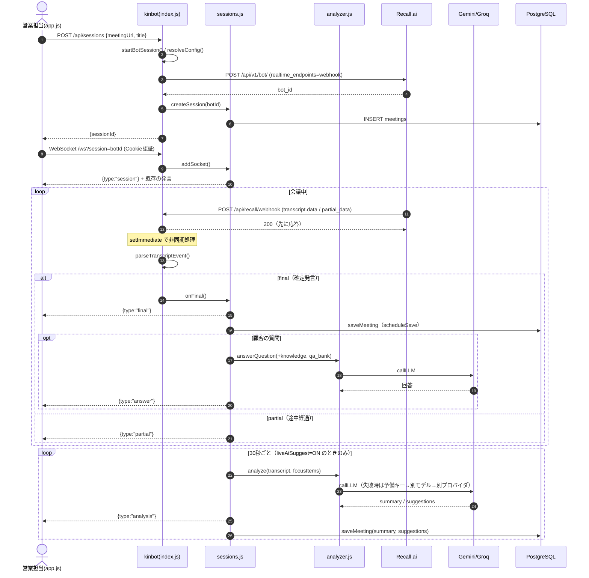

## SQ02 商談終了〜事後処理

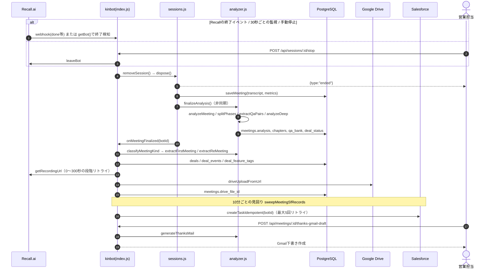

## SQ03 カレンダー自動入室（予約Bot）

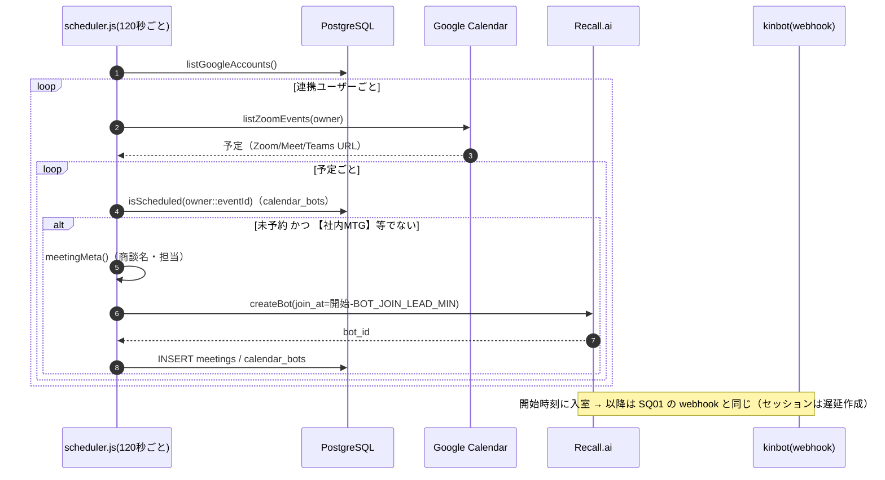

別経路：`startAutoJoinCalendarMonitor`（60秒ごと、`auto_join_meetings` の登録URLと予定を照合）、`POST /api/zoom/webhook`（`meeting.started` を受けて入室。HMAC署名を検証）。

## SQ04 アポ検知 → 担当割当 → 確定メール → SF立ち上げ

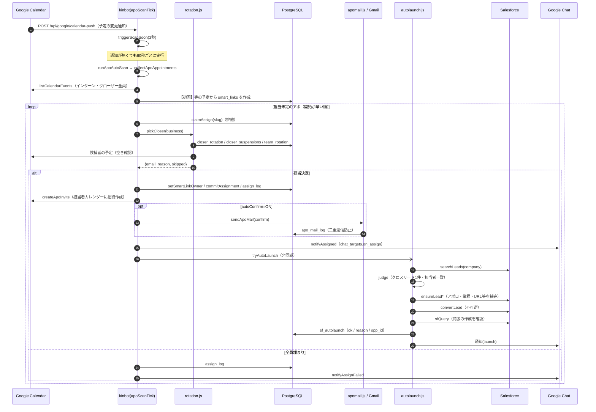

## SQ05 架電（kincall）と結果記録

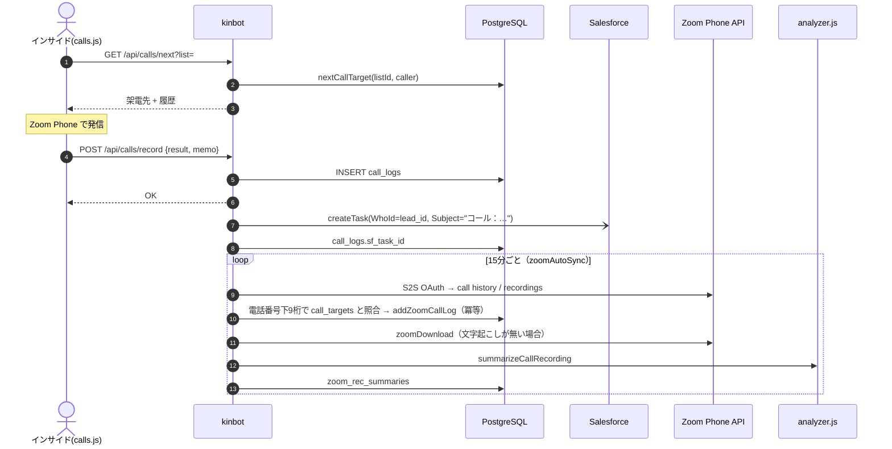

## SQ06 プロセスシート書き込み

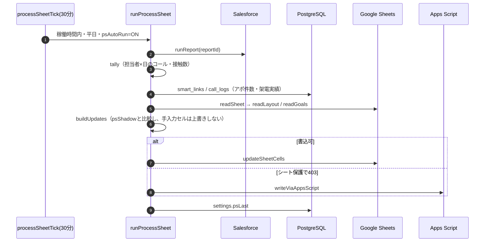

## SQ07 資料トラッキング

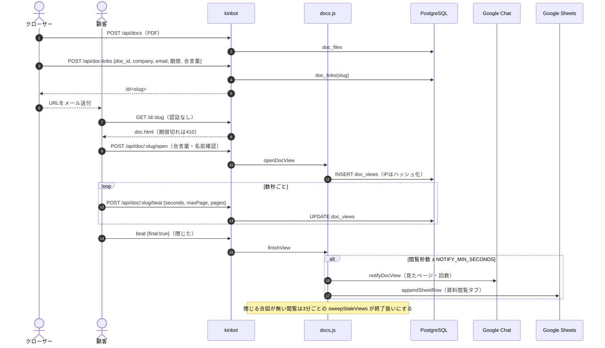

## SQ08 外部AI連携（OAuth 2.0 + MCP）

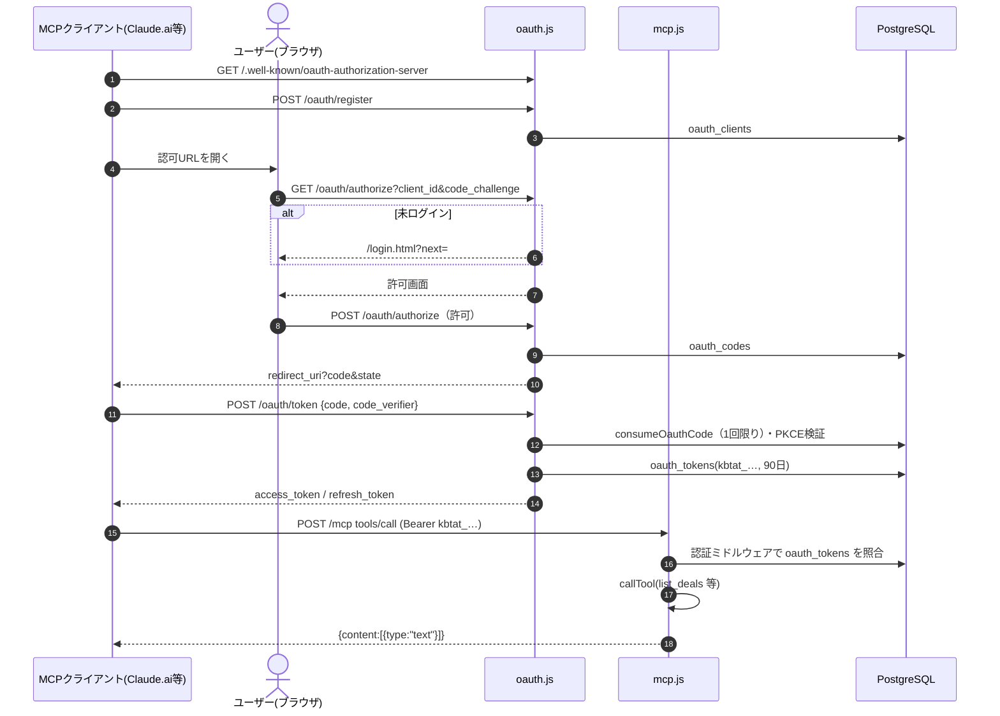

## SQ09 ログイン

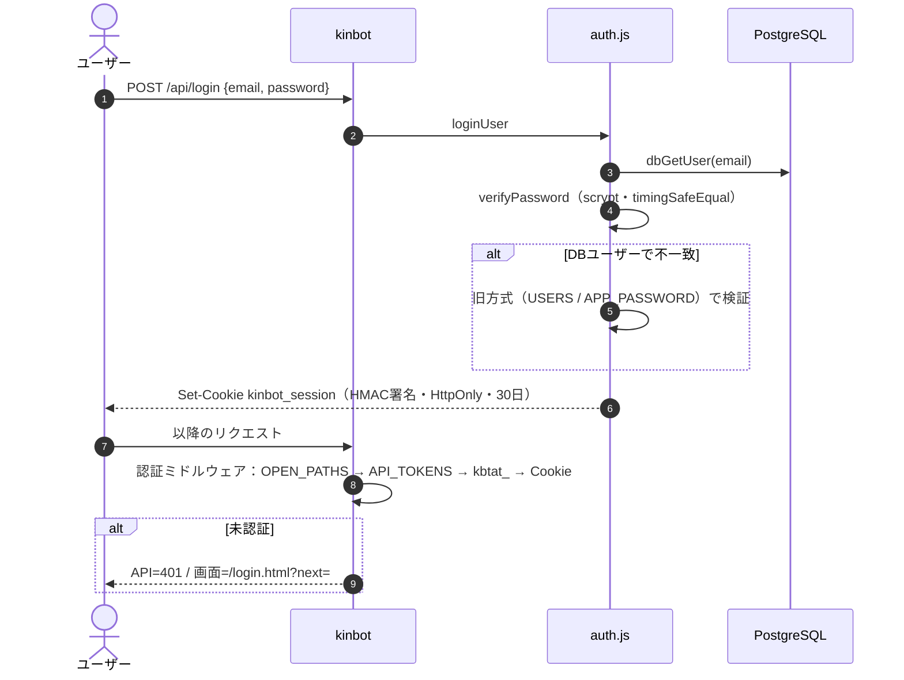

## SQ10 kinXs 自動更新（AR）の解約フォーム取込

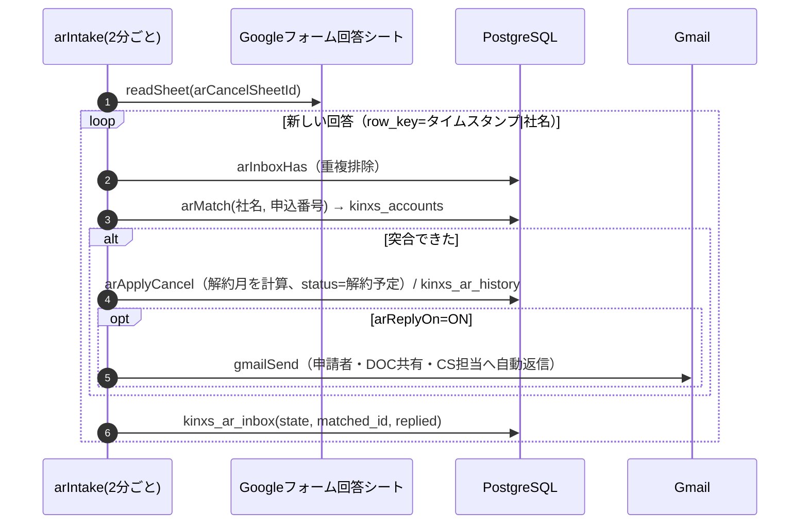

## SQ11 MiiTel 会議の取込（拡張機能）

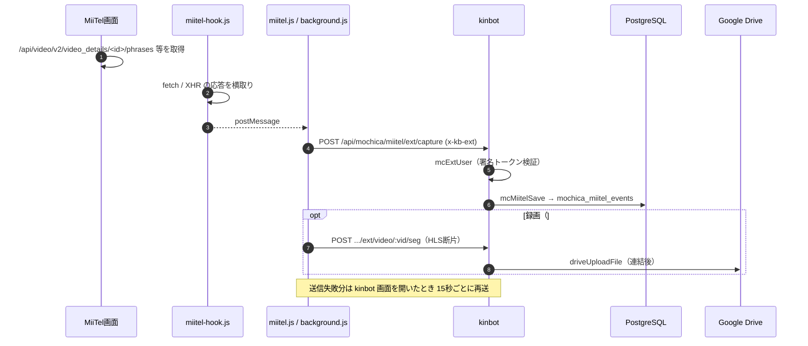
