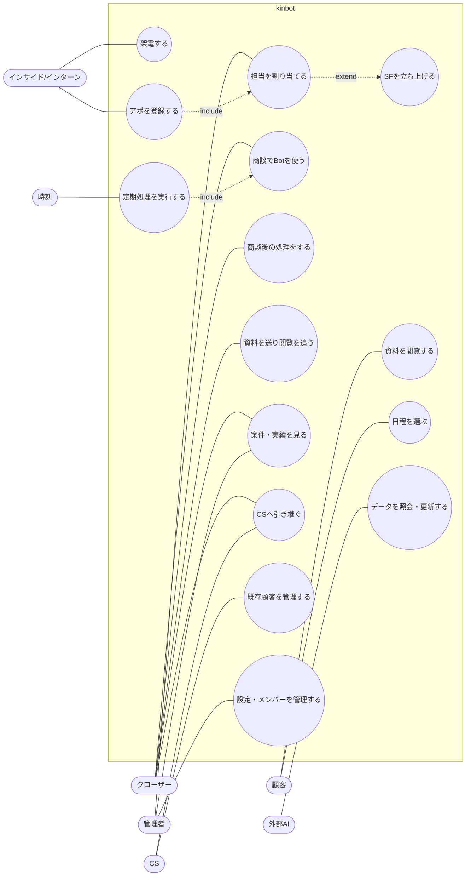
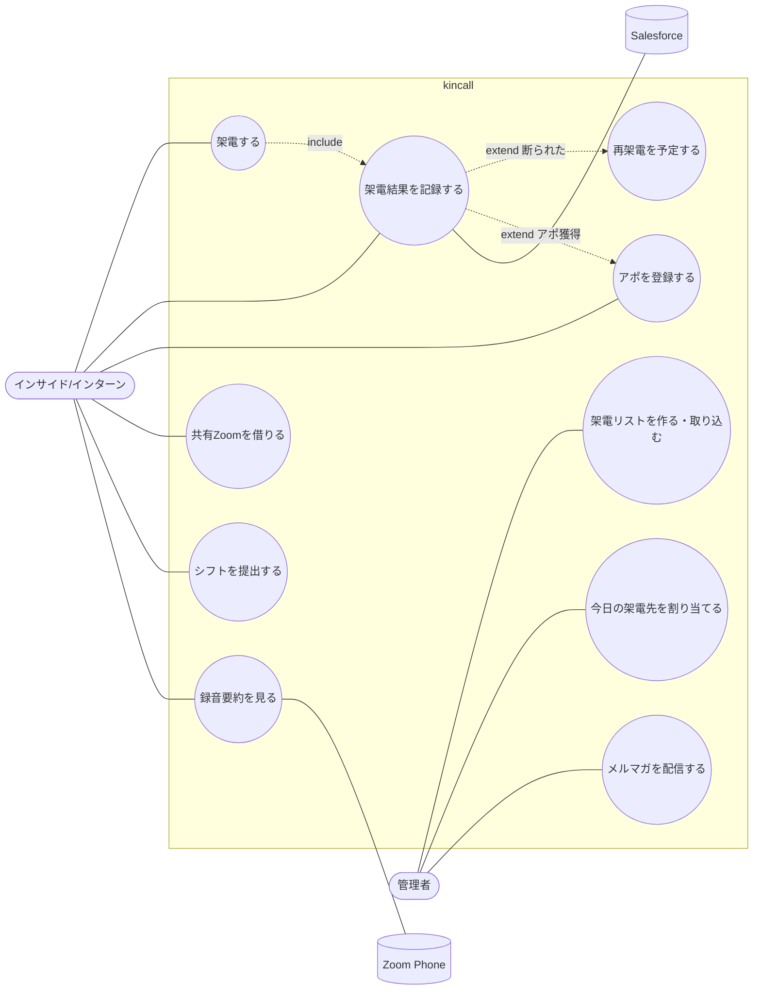
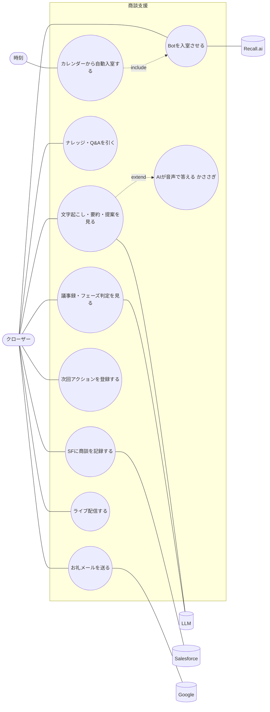
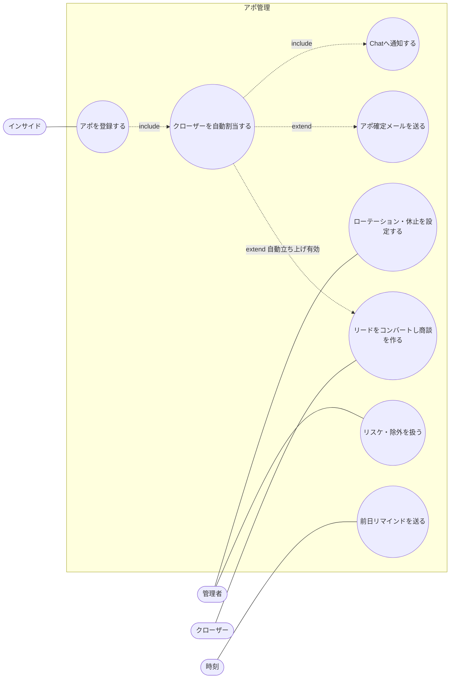
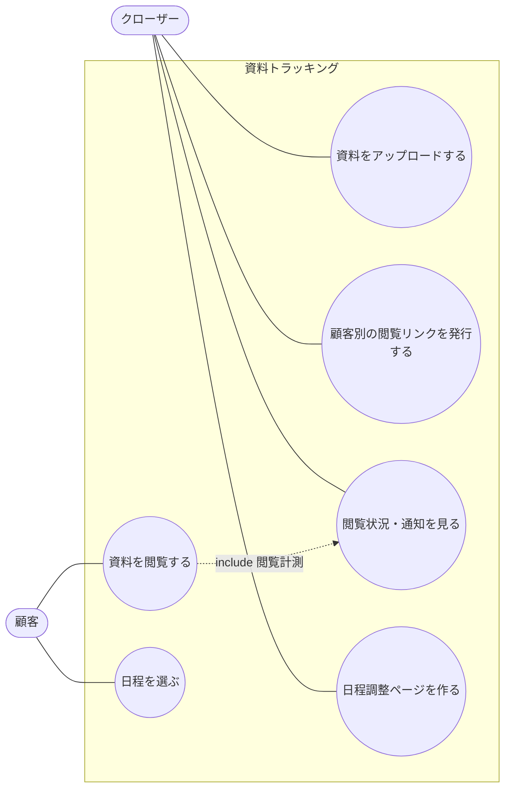

# kinbot ユースケース図

> Mermaid にはUMLユースケース図の記法が無いため、`flowchart` でアクター（左右）とユースケース（楕円）を表す。

## アクター

| アクター | 説明 |
|---|---|
| インサイド / インターン | 架電してアポを取る。シフトを提出する |
| クローザー（FS） | アポを担当し、商談する。商談後の記録・フォローを行う |
| CS | 受注後の既存顧客を担当する（kinXs） |
| 管理者（admin） | メンバー・割当ルール・通知・設定を管理する |
| MOCHICA営業 | MiiTelの会議をkinbotへ取り込む |
| 顧客 | 資料を閲覧し、日程を選ぶ（ログイン不要） |
| 外部AI（Claude / ChatGPT） | MCP / GPT Actions で kinbot を参照・更新する |
| 時刻（スケジューラ） | 定期処理を起動する |
| 外部システム | Recall.ai / Salesforce / Google / Zoom / MiiTel / LLM |

## 1. 全体



## 2. 架電・アポ（kincall）



## 3. 商談（kinbot本体）



## 4. アポ割当・SF立ち上げ



## 5. 資料・顧客接点



## 6. CS・既存顧客（kinXs）／外部AI

```mermaid
flowchart LR
  CL([クローザー])
  CS([CS])
  XA([外部AI])
  MO([MOCHICA営業])
  subgraph CS・kinXs
    e1((キックオフを登録する))
    e2((CS確認日程を決める))
    e3((更新月・更新確度を管理する))
    e4((CSタスクを処理する))
    e5((顧客メールの下書きを作る))
    e6((自動更新の解約申込を取り込み照合する))
  end
  subgraph 外部連携
    f1((OAuthで接続する))
    f2((商談・案件・架電を照会する))
    f3((SFを照会・更新する))
    f4((MiiTel会議を取り込む))
  end
  CL --- e1
  CS --- e2 & e3 & e4 & e5 & e6
  e1 -. include .-> e2
  XA --- f1 & f2 & f3
  f2 -. include .-> f1
  MO --- f4
```
