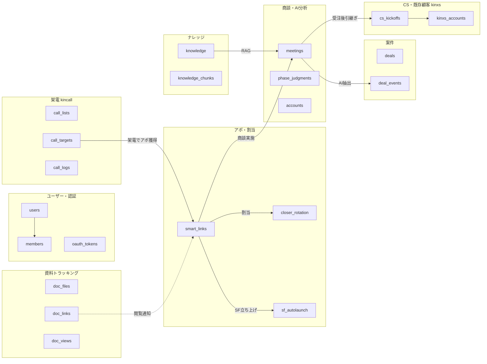
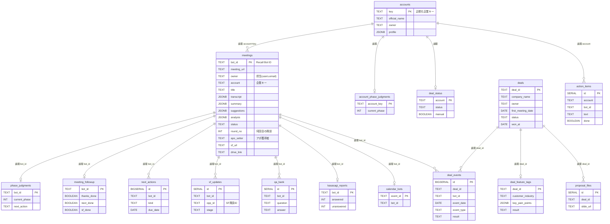
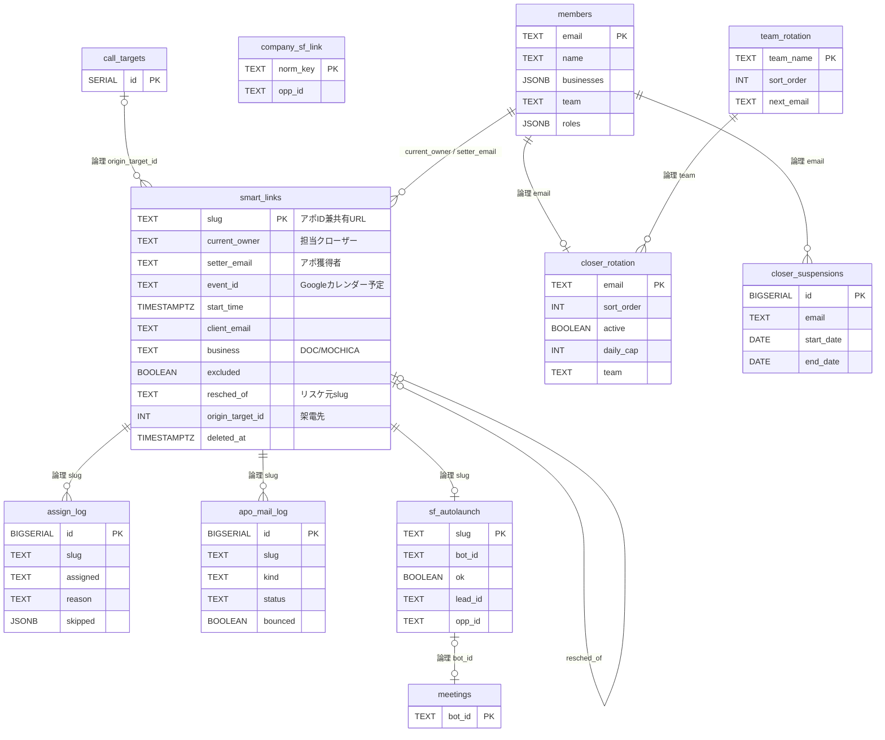
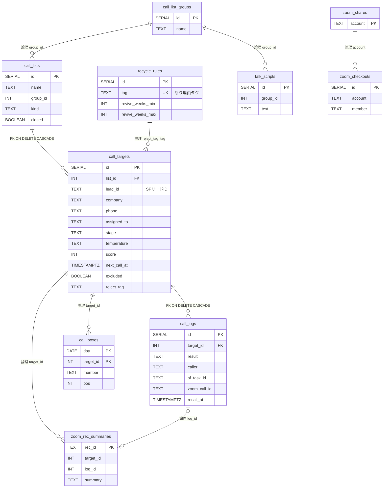
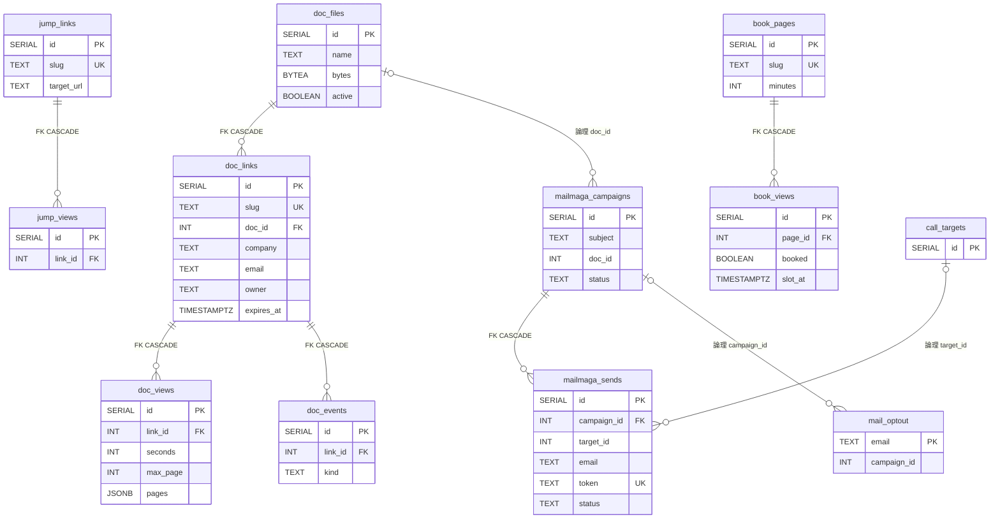
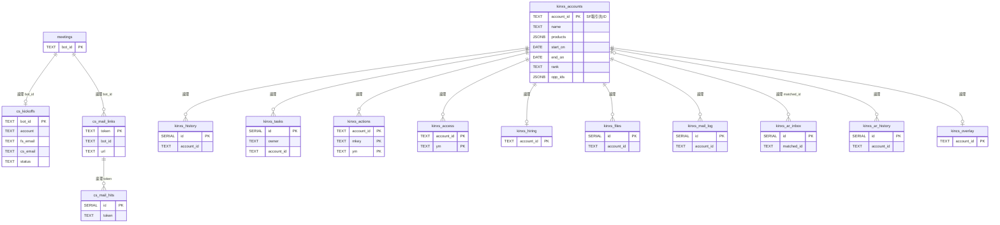
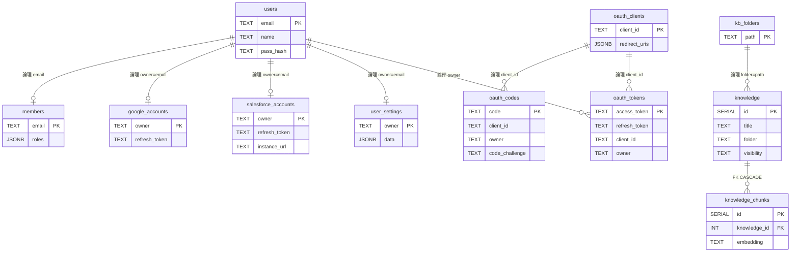

# kinbot ER図

> 全107テーブルのうち、業務上の関係があるものを領域ごとに図示する。列の詳細は [06_DBモデル.md](06_DBモデル.md) を参照。
>
> **注意**: DB上で `REFERENCES`（外部キー制約）が張られているのは一部だけ（実線で「FK」と表記）。
> それ以外は `bot_id` / `deal_id` / `slug` / `email` / `account_id` などの**値で論理的に結合**している（「論理」と表記）。
> 人を表す列（`owner` / `caller` / `assigned_to` 等）は基本的に `users.email` / `members.email` の値を持つ。

## 全体俯瞰（領域間の関係）

## 1. 商談・案件

## 2. アポ・担当割当・Salesforce立ち上げ

## 3. 架電（kincall）

## 4. 資料トラッキング・リンク・メール配信

## 5. CS・既存顧客（kinxs）

## 6. ユーザー・認証・ナレッジ

## 外部キー制約（DBで実際に張られているもの）

| 子テーブル.列 | 親テーブル.列 | 削除時 |
|---|---|---|
| knowledge_chunks.knowledge_id | knowledge.id | CASCADE |
| book_views.page_id | book_pages.id | CASCADE |
| jump_views.link_id | jump_links.id | CASCADE |
| call_targets.list_id | call_lists.id | CASCADE |
| call_logs.target_id | call_targets.id | CASCADE |
| doc_links.doc_id | doc_files.id | CASCADE |
| doc_views.link_id | doc_links.id | CASCADE |
| doc_events.link_id | doc_links.id | CASCADE |
| mailmaga_sends.campaign_id | mailmaga_campaigns.id | CASCADE |

それ以外の関係はアプリ側（`server/db.js` のSQL）で値を突き合わせて結合している。
